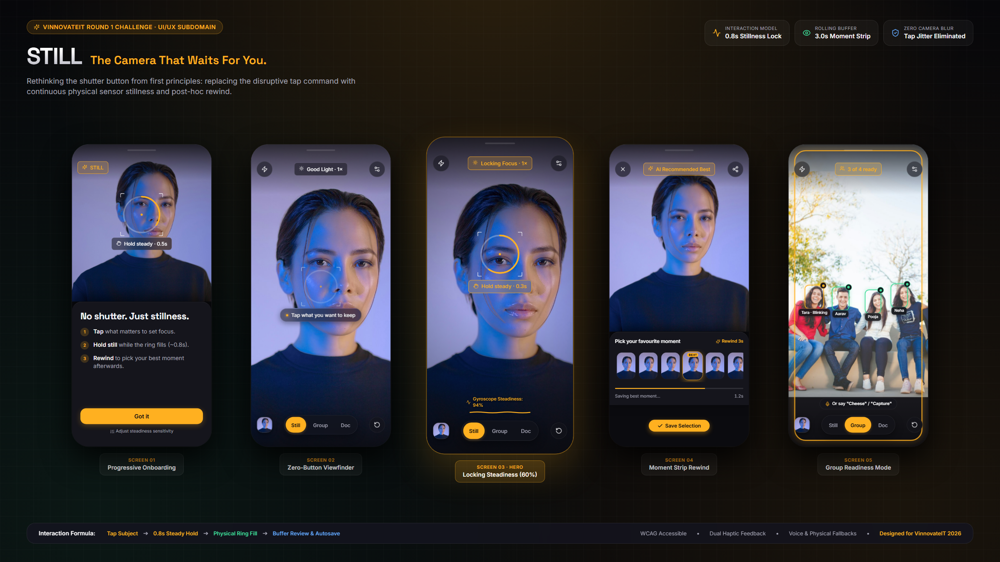

# STILL — The Camera That Waits For You

A mobile camera prototype that replaces the physical shutter button with continuous stillness detection and a simulated 3-second rewind buffer.

[](https://vitejs.dev/)
[](https://react.dev/)
[](https://www.typescriptlang.org/)
[](docs/QA-report.md)
[](LICENSE)

> **VinnovateIT UI/UX Round 1 Challenge Submission**  
> *"Where Did My Button Go? — Rethink the Interaction"*  
> **Author:** Vaibhav Mittal ([@vaibhavmittal29](https://github.com/vaibhavmittal29))

---

## 📌 The Problem

The shutter button historically fulfilled five jobs: declaring capture intent, freezing a split-second, confirming capture, providing a thumb target, and maintaining a familiar mental model. But tapping flat glass has an inherent flaw: the physical finger tap induces device tremor at the exact instant of exposure.

Naive workarounds — like volume-key triggers or full-screen tapping — simply relocate the physical button and preserve the shake penalty. STILL resolves this contradiction: phone stillness itself becomes the capture trigger.

---

## 💡 The Solution: STILL

Instead of tapping to take a photo, STILL introduces a calm, 3-step capture gesture:

1. **Tap subject to anchor focus:** Tap anywhere across the edge-to-edge viewfinder. An amber focus pin anchors on the subject.
2. **Hold steady for 0.8 seconds:** A 104px physical ring fills linearly as the phone steadies. Capture occurs automatically after the tap's jolt has settled.
3. **Rewind to choose afterwards:** A simulated 3-second buffer presents a 7-frame **Moment Strip**. The sharpest frame is preselected, auto-saves after 4 seconds, and includes a 5-second reversible Undo.



---

## 📱 The 5 High-Fidelity Screens

All screens are designed for mobile viewports (390 × 844 px) and exported at **1170 × 2532 px (Retina 3×)**:

| # | Screen Name | Key Interaction | High-Res Export | Live Route |
|---|---|---|---|---|
| **01** | **Progressive Onboarding** | 3-step progressive coach card introducing the zero-button gesture. | [screen-01-onboarding.png](export/screens/screen-01-onboarding.png) | [`/?screen=onboarding`](http://localhost:5173/?screen=onboarding) |
| **02** | **Viewfinder (Idle)** | Calm, uncluttered optical canvas with ghost ring and dwell prompt. | [screen-02-idle.png](export/screens/screen-02-idle.png) | [`/?screen=idle`](http://localhost:5173/?screen=idle) |
| **03** | **Locking (Mid-Action)** | **Hero Screen:** 104px LockRing at 60%, 0.3s chip & steadiness meter. | [screen-03-locking.png](export/screens/screen-03-locking.png) · [Annotated](export/screens/screen-03-locking-annotated.png) | [`/?screen=locking&progress=0.6`](http://localhost:5173/?screen=locking&progress=0.6) |
| **04** | **Moment Strip** | 7-frame buffer review, preselected Best frame, 4s autosave & 5s undo. | [screen-04-moments.png](export/screens/screen-04-moments.png) | [`/?screen=moments&selected=3`](http://localhost:5173/?screen=moments&selected=3) |
| **05** | **Group Mode** | Multi-face tracking (4 faces); fires only when everyone is ready. | [screen-05-group.png](export/screens/screen-05-group.png) | [`/?screen=group&ready=3`](http://localhost:5173/?screen=group&ready=3) |

---

## 📂 Challenge Deliverables Index

| Deliverable | Description | File Links |
|---|---|---|
| **D1: Problem Statement** | 148-word problem definition & 5 shutter jobs analysis | [`docs/D1-problem.md`](docs/D1-problem.md) |
| **D2: Interaction Model & User Flow** | Deterministic FSM state machine architecture & vector flow | [`docs/D2-user-flow.mmd`](docs/D2-user-flow.mmd) · [`export/user-flow.svg`](export/user-flow.svg) · [`export/user-flow.png`](export/user-flow.png) |
| **D3: 5 Hi-Fi Screens** | Retina 3× exports (1170 × 2532 px) covering all core states | [`export/screens/`](export/screens/) (All 5 screens + annotated hero) |
| **D4: Key Design Decisions** | Approved 7-point design rationale ($\le 200$ words) | [`docs/D4-design-decisions.md`](docs/D4-design-decisions.md) |
| **Case Study Presentation PDF** | Multi-page A4 portfolio case study document | [`export/case-study.pdf`](export/case-study.pdf) · [`CaseStudyScreen.tsx`](src/screens/CaseStudyScreen.tsx) |
| **Hero Composite Banner** | Panoramic presentation elevation (2400 × 1350 px) | [`export/hero-composite.png`](export/hero-composite.png) |
| **Pitch & Jury Defense Guide** | 60-second spoken pitch, 3-min presentation & 7-question defense | [`docs/pitch-60s.md`](docs/pitch-60s.md) |
| **QA & Accessibility Report** | Contrast audit, touch-target verification & test execution logs | [`docs/QA-report.md`](docs/QA-report.md) · [`AUDIT-REPORT.md`](AUDIT-REPORT.md) |
| **Design System & Tokens** | Color palette, spatial scale, typography & token definitions | [`docs/design-system.md`](docs/design-system.md) · [`tokens.css`](src/styles/tokens.css) |
| **Asset Attribution** | Unsplash photo licenses and typography credits | [`docs/CREDITS.md`](docs/CREDITS.md) |

---

## 🔄 Interaction Model & Finite State Machine

STILL operates on a deterministic 6-state finite state machine with automatic recovery paths:

- **`IDLE`:** Viewfinder live, subtle ghost ring pulsing, coachmark guides intent.
- **`FOCUSED`:** User taps subject at `(x, y)`; focus anchor placed; 3s dwell timeout begins.
- **`LOCKING`:** Device steadiness detected; amber LockRing sweeps linearly for 0.8 s.
- **`CANCELLED`:** Hand shakes beyond 250 ms grace window; ring drains at 2× speed; focus pin retained for immediate re-lock.
- **`CAPTURED`:** Lock completes 100%; shutter sound and synthetic haptics confirm capture.
- **`REVIEW`:** Moment Strip slides up with preselected Best frame; 4s autosave countdown active.
- **`SAVED`:** Frame committed to gallery; 5s persistent toast offers single-tap Undo.

*See the full architecture diagram in [`docs/D2-user-flow.mmd`](docs/D2-user-flow.mmd) and [`export/user-flow.svg`](export/user-flow.svg).*

---

## ♿ Accessibility & Ergonomics

- **Touch Target Sizing:** Every interactive control enforces a minimum bounding box of **44 × 44 CSS pixels**, complying with Apple Human Interface Guidelines and satisfying WCAG 2.2 Success Criteria 2.5.8 (Level AA, 24px) and 2.5.5 (Level AAA, 44px).
- **Color Contrast:** Mathematically verified against dark backgrounds (`#0B0B0F`):
  - Primary text (`#F5F5F7`): **18.0 : 1** (WCAG AAA)
  - Signal Amber (`#FFB020`): **10.7 : 1** (WCAG AAA)
  - Success Green (`#3DDC97`): **11.1 : 1** (WCAG AAA)
  - Movement Warning (`#FF6B5E`): **7.0 : 1** (WCAG AA normal, AAA large)
  - Secondary text (`#A3A3B2`): **7.9 : 1** (WCAG AAA)
- **Screen Reader Announcements:** Dynamic live region (`aria-live="polite"`) announces camera state changes, countdown seconds, and save confirmations in real time.
- **Vestibular Motion Safety:** Honors `prefers-reduced-motion` by replacing continuous sweeps with discrete stepped percentage ticks (33% → 66% → 100%).
- **Inclusive Fallbacks:** Adjustable hold time in settings (400–1500 ms), voice trigger (*"Capture"* / *"Cheese"*), and physical key trigger ('C' key). *Note: Voice trigger and volume key capture are simulated in this browser prototype; native iOS/Android builds would connect directly to platform volume buttons and speech APIs.*

---

## 🛠️ How to Run Locally

### 1. Prerequisites
- Node.js 18+ (tested on Node.js 20+)
- npm 9+

### 2. Setup & Installation
```bash
# Clone the repository
git clone https://github.com/vaibhavmittal29/where-did-my-button-go.git
cd where-did-my-button-go

# Install dependencies
npm install

# Optional: Install Playwright browser for running automated tests & exports
npx playwright install chromium
```

### 3. Run Development Server
```bash
npm run dev
```
Open **`http://localhost:5173/`** in your browser.

### 4. Interactive Keyboard Simulation
- **Spacebar (Hold):** Simulates holding the device steady.
- **Spacebar (Release):** Simulates hand movement / camera shake (triggers ring drain).
- **'C' Key:** Simulates physical volume button accessibility fallback.
- **STILL Lab Panel (Desktop):** Real-time steadiness slider, manual shake trigger, mode switcher, and sound/haptic toggles.

### 5. Run Test Suite
```bash
npm test
```
Runs state machine unit tests (`test:machine`), Playwright browser interactive tests (`test:e2e`), and motion safety tests (`test:motion`).

### 6. Re-Export Deliverables
```bash
npm run export
```
Re-generates all 6 retina screens (1170 × 2532 px), the panoramic composite (2400 × 1350 px), and the case study PDF.

---

## 🔗 Deterministic Interactive Routes

The application includes dedicated routes for direct inspection of every state and deliverable:

- **Live Interactive Camera & Lab:** [`http://localhost:5173/`](http://localhost:5173/) or [`/?screen=live`](http://localhost:5173/?screen=live)
- **Screen 1 (Progressive Onboarding):** [`/?screen=onboarding`](http://localhost:5173/?screen=onboarding)
- **Screen 2 (Viewfinder Idle):** [`/?screen=idle`](http://localhost:5173/?screen=idle)
- **Screen 3 (Hero Locking Mid-Action):** [`/?screen=locking&progress=0.6`](http://localhost:5173/?screen=locking&progress=0.6)
- **Screen 3 (Annotated Hero):** [`/?screen=locking&progress=0.6&annotate=1`](http://localhost:5173/?screen=locking&progress=0.6&annotate=1)
- **Screen 4 (Moment Strip Review):** [`/?screen=moments&selected=3`](http://localhost:5173/?screen=moments&selected=3)
- **Screen 5 (Group Mode):** [`/?screen=group&ready=3`](http://localhost:5173/?screen=group&ready=3)
- **Component Kit Showcase:** [`/?screen=kit`](http://localhost:5173/?screen=kit)
- **Panoramic Hero Composite:** [`/?screen=hero-composite`](http://localhost:5173/?screen=hero-composite)
- **Full Case Study Document:** [`/?screen=case-study`](http://localhost:5173/?screen=case-study)

---

## 📜 Development History

For the complete phased progression log and semantic commit history, see [`docs/CHANGELOG.md`](docs/CHANGELOG.md).

---

## 👤 Author & License

- **Author:** Vaibhav Mittal ([@vaibhavmittal29](https://github.com/vaibhavmittal29))
- **Email:** [vaibhavmittalwork@gmail.com](mailto:vaibhavmittalwork@gmail.com)
- **Repository:** [https://github.com/vaibhavmittal29/where-did-my-button-go](https://github.com/vaibhavmittal29/where-did-my-button-go)
- **License:** [MIT License](LICENSE) — Copyright © 2026 Vaibhav Mittal
