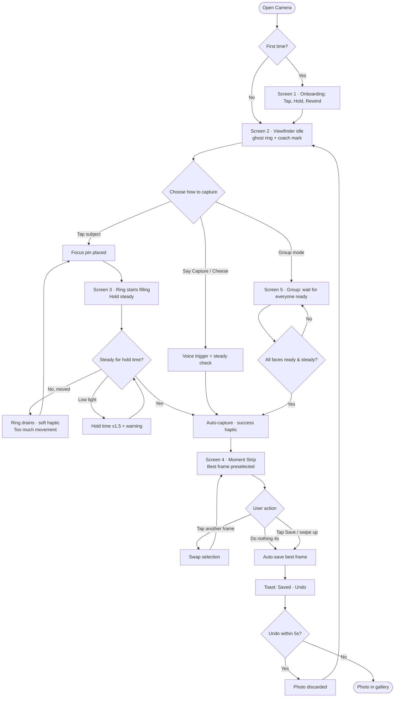

# PLAN.md — "Where Did My Button Go?"
### Camera app with **no shutter button** → concept: **STILL**
**Project:** VinnovateIT (VIT Vellore) · UI/UX subdomain · Round 1 recruitment task
**Builder:** a CSE-core fresher (UI/UX beginner). The agent must explain things simply and never skip steps.
**Hard deadline:** Round 1 closes ~1 day 13 hours after this plan was written. Plan is sized to finish with buffer.

---

## 0. HOW TO USE THIS FILE (read first — humans and the agent)

**For the human:**
1. Create an empty folder `still-camera/`. Save this file inside it as `PLAN.md`.
2. Open that folder as a workspace in Antigravity.
3. Open the Agent Manager, start a new task, use **Planning mode** for Phases 0, 2, 5 and 8 (Fast mode is fine for polish phases).
4. Paste this as your first message:

```text
Read PLAN.md fully. Do NOT start building yet. First produce an Implementation Plan artifact
and a Task List artifact summarising Phases 0-10. Then execute ONLY Phase 0.
When Phase 0's acceptance criteria are met, stop and wait for me to say "Go Phase 1".
Never move to the next phase on your own.
```

5. After each phase, review the output yourself (look at the screenshots/browser recording the agent produces), then say `Go Phase N`.
6. If the agent drifts, say: `Re-read the "Agent Operating Rules" section of PLAN.md and continue.`

> Menu names in Antigravity can differ slightly between versions. Anything described as a feature (Planning mode, artifacts, browser subagent, rules/workflows) is a guide, not a guarantee. If a feature is missing, the agent should just do the equivalent manually.

**For the agent:** this file is the single source of truth. If something in a chat message contradicts it, ask once, then follow the chat.

---

## 1. THE BRIEF (restated so nothing is missed)

**Task title:** *Where did my button go? — Rethink the Interaction*

**Objective:** Take a familiar digital product and remove one interaction that is essential to how it works. Redesign the experience so users can still accomplish the same goal **without simply replacing the missing button**.

**Choose any one:** Spotify (no Play/Pause) · WhatsApp (no Send) · Google Maps (no Location Pin) · **Camera (no Shutter) ← CHOSEN** · Food Delivery (no Cart)

**Guidelines from the brief:**
- Do not simply move the missing button.
- Rethink the interaction itself.
- Redesigned experience must remain **intuitive**.
- May use gestures, voice, contextual actions, or an entirely new interaction model.
- There is no single correct solution.

**Deliverables (all four are mandatory):**
| # | Deliverable | Where it lives in this project |
|---|---|---|
| D1 | Brief explanation of the interaction removed and the problem it creates | `docs/D1-problem.md` + slide 1 of the case study |
| D2 | User flow showing the redesigned interaction | `docs/D2-user-flow.mmd` → `export/user-flow.png` / `.svg` |
| D3 | 3–5 high-fidelity screens | `export/screens/01…05.png` (5 screens, 1170×2532) |
| D4 | Brief explanation of key design decisions | `docs/D4-design-decisions.md` + slide in the case study |

**What the evaluators say they want:** creative problem solving · interaction design · ability to rethink familiar UX patterns.
**Their closing line (our north star):** *"Don't just replace the button. Rethink why the button existed in the first place."*

**Scoring strategy (what we optimise for):**
1. Clear "why the button existed" analysis (shows thinking, not decoration) — 35%
2. A genuinely different interaction model that is still intuitive — 30%
3. Clean, consistent hi-fi screens — 20%
4. Crisp communication (short, scannable writing) — 15%

---

## 2. CONCEPT DECISION (locked — do not change without asking the human)

### 2.1 Why Camera / No Shutter
- Most applicants will pick Spotify or WhatsApp. Camera gives a visual, demo-able, less-common answer.
- The shutter has a rich "why it existed" story, which is exactly what the brief asks us to rethink.
- Hi-fi screens look great (full-bleed photography, dark UI), which makes the screens deliverable strong.

### 2.2 Why the shutter button existed (its 5 real jobs)
| # | Job | Explanation |
|---|-----|-------------|
| 1 | **Intent** | It is the one unambiguous "I want a photo *now*" signal. |
| 2 | **Timing** | It lets the user choose the exact moment. |
| 3 | **Feedback** | Press → sound/flash/animation → "it worked". |
| 4 | **Reachability** | A big, fixed target the thumb can find without looking. |
| 5 | **A hidden flaw** | Pressing a screen button shakes the phone, causing blur — the button *itself* hurts photo quality. |

### 2.3 The problem when it's removed
Without a shutter the user has no way to say "now", risks accidental captures or missed moments, and gets no confirmation. The naive fix (a different button, a volume key, a tap-anywhere) just relocates the same flaws.

### 2.4 The idea: **STILL — "Hold still to capture. Rewind to choose."**
Replace *"press to capture"* with *"steadiness = consent"* and *"choose the moment after, not before."*

**Three layers of interaction:**
1. **Tap → Hold Steady → Capture (primary).** Tap the subject (this already means "focus here" in every camera app, so zero new learning). A ring appears on that spot. Hold the phone steady ~0.8 s; the ring fills; the photo is taken automatically when the phone is steady. If the user moves, the ring drains and nothing is captured. *This fixes the camera-shake flaw because the shot is taken at the steadiest moment.*
2. **Rewind (the safety net).** The camera silently keeps a ~3 s rolling buffer. After capture, a **Moment Strip** shows ~7 nearby frames with a suggested frame pre-selected ("Suggested"). Tap another to swap. If the user does nothing, the selection is saved after 4 s. *This removes "timing anxiety" — the old job #2.*
3. **Context modes (smart intent).**
   - **Group:** capture auto-triggers when everyone's face is in frame, eyes open, and phone is steady ("4 of 4 ready").
   - **Hands-free:** say "Capture" / "Cheese", or use volume keys as an accessibility fallback.

**Why this is not "just moving the button":** there is no new control for capture. The *interaction model* changes from *discrete command* → *continuous, sensor-driven intent + post-hoc selection*.

### 2.5 Prior art (be honest in the case study — shows maturity)
Features in this neighbourhood exist (smile/auto timers, palm-gesture timers, Live Photo key-frame choice, burst "best shot" suggestions). STILL's difference: it makes **stillness the primary capture trigger via tap-to-focus**, makes **post-capture frame choice the default safety net**, and **removes the shutter from the main flow entirely** instead of adding extras beside it.

---

## 3. AGENT OPERATING RULES (non-negotiable)

1. **Phase gates:** finish one phase, show proof (screenshots / recording / file list), stop, wait for `Go Phase N`.
2. **Teach as you build:** after each phase write a 5-line plain-English summary of what was done and why. The human is a beginner.
3. **No scope creep:** only features listed here. Ask before adding libraries.
4. **Dependencies allowed:** `react`, `react-dom`, `typescript`, `vite`, `framer-motion`, `@fontsource/inter`, `@fontsource/space-grotesk`, `lucide-react`, `playwright` (dev only, for exports). Nothing else without asking.
5. **No backend, no accounts, no analytics.** Pure static front-end.
6. **No copyrighted/branded assets.** No Apple/Google/Samsung logos or UI clones. Photos must be royalty-free (Unsplash/Pexels/Pixabay) or AI-generated, with credits in `docs/CREDITS.md`.
7. **Design tokens only:** never hard-code a colour, radius, spacing or duration in a component — use CSS variables from `src/styles/tokens.css`.
8. **Accessibility from the start:** semantic HTML, labels, focus states, `prefers-reduced-motion` support, 44×44 px minimum touch targets, WCAG AA contrast.
9. **Deterministic screens:** every screen must be reachable via URL, e.g. `/?screen=locking&progress=0.6`, so exports are repeatable.
10. **Verify visually:** after each UI phase, open the app in the browser tool, take screenshots at 390×844, and fix visible problems before reporting.
11. **Git hygiene:** commit at the end of each phase with message `phase-N: <summary>`.
12. **Never fabricate** user research numbers or statistics. If data is illustrative, label it "illustrative".

---

## 4. TECH STACK & REPO STRUCTURE

**Stack:** Vite + React + TypeScript · CSS variables + CSS Modules (no Tailwind — fewer moving parts) · Framer Motion for animation · Vanilla Web APIs: `navigator.vibrate`, `DeviceMotionEvent` (optional live mode), `getUserMedia` (optional live mode).

**Why a coded prototype for a design task?** The interaction is *time- and motion-based* (hold, drain, rewind). A static mock can't show it. Code lets us build an interactive demo AND export pixel-perfect hi-fi screens. (We still recreate the screens in Figma — see Phase 9.)

```text
still-camera/
├─ PLAN.md
├─ README.md
├─ index.html
├─ package.json
├─ docs/
│  ├─ D1-problem.md
│  ├─ D2-user-flow.mmd
│  ├─ D4-design-decisions.md
│  ├─ interaction-spec.md
│  ├─ case-study.md
│  └─ CREDITS.md
├─ public/
│  └─ scenes/            # royalty-free or generated photos used as the "viewfinder"
├─ scripts/
│  └─ export-screens.mjs # Playwright: screenshots + PDF
├─ export/
│  ├─ screens/           # 01-onboarding.png … 05-group.png
│  ├─ user-flow.png / .svg
│  └─ case-study.pdf
└─ src/
   ├─ main.tsx
   ├─ App.tsx            # reads ?screen= & ?progress= for deterministic states
   ├─ styles/
   │  ├─ tokens.css
   │  └─ global.css
   ├─ state/
   │  └─ cameraMachine.ts   # reducer-based state machine
   ├─ hooks/
   │  ├─ useSteadiness.ts   # simulated + real (DeviceMotion) steadiness 0..1
   │  ├─ useHaptics.ts
   │  └─ useReducedMotion.ts
   ├─ components/
   │  ├─ PhoneFrame/
   │  ├─ Viewfinder/
   │  ├─ LockRing/
   │  ├─ MomentStrip/
   │  ├─ ModeCarousel/
   │  ├─ CoachMark/
   │  ├─ FaceChips/
   │  ├─ Toast/
   │  └─ DemoPanel/         # outside the phone: steadiness slider, reset, screen jump
   └─ screens/
      ├─ OnboardingScreen.tsx
      ├─ ViewfinderIdleScreen.tsx
      ├─ LockingScreen.tsx
      ├─ MomentStripScreen.tsx
      └─ GroupModeScreen.tsx
```

---

## 5. DESIGN SYSTEM (put these into `tokens.css` in Phase 3)

**Mood:** calm, precise, "quiet confidence". The UI gets out of the way; the photo is the hero. Dark UI (camera apps are used in all lighting, dark reduces glare and makes the viewfinder pop).

### 5.1 Colour
| Token | Hex | Use |
|---|---|---|
| `--bg` | `#0B0B0F` | App background / letterbox |
| `--surface-1` | `#15151C` | Cards, sheets |
| `--surface-2` | `#1F1F2A` | Chips, raised elements |
| `--glass` | `rgba(20,20,28,0.55)` | Blurred overlays (with `backdrop-filter: blur(16px)`) |
| `--text` | `#F5F5F7` | Primary text |
| `--text-dim` | `#A3A3B2` | Secondary text |
| `--accent` | `#FFB020` | "Signal amber": ring fill, active mode, Best badge |
| `--accent-soft` | `rgba(255,176,32,0.18)` | Accent backgrounds |
| `--success` | `#3DDC97` | Ready / saved |
| `--danger` | `#FF6B5E` | Unsteady / error |
| `--ring-track` | `rgba(255,255,255,0.28)` | Empty ring |

Contrast check required: `--text` on `--bg` ≥ 7:1; `--accent` on `--bg` ≥ 4.5:1; any text on `--glass` must be verified over bright photos (add a subtle text-shadow or darker scrim if it fails).

### 5.2 Typography
- **Display / headings:** Space Grotesk (600–700)
- **UI / body:** Inter (400, 500, 600)
- Scale (px): 12 caption · 14 small · 16 body · 20 title · 28 headline · 40 display
- Line-height 1.4 body, 1.15 display. Numbers use `font-variant-numeric: tabular-nums`.

### 5.3 Spacing, radius, elevation
- 8-pt grid: 4, 8, 12, 16, 24, 32, 48.
- Radius: 8 chip · 16 card · 28 sheet · 999 pill.
- Elevation: no heavy shadows; use blur + 1px `rgba(255,255,255,0.08)` borders.

### 5.4 Motion tokens
| Token | Value | Use |
|---|---|---|
| `--dur-fast` | 120ms | Taps, chip changes |
| `--dur-base` | 240ms | Panels, strip slide-in |
| `--dur-slow` | 480ms | Onboarding transitions |
| `--ease-out` | `cubic-bezier(0.2, 0.8, 0.2, 1)` | Entrances |
| `--ease-in-out` | `cubic-bezier(0.4, 0, 0.2, 1)` | Moves |
| Ring fill | linear, driven by steadiness time | Must feel *physical*, not eased |

Respect `prefers-reduced-motion`: replace ring sweep with a stepped percentage + haptic/audio only.

### 5.5 Iconography
`lucide-react`, 1.75px stroke, 24px. Icons used: `Hand`, `Mic`, `Users`, `FileText`, `Settings2`, `RotateCcw`, `Check`, `Sparkles`. No shutter icon anywhere (that's the point).

---

## 6. INTERACTION SPEC (for `docs/interaction-spec.md` and `cameraMachine.ts`)

### 6.1 States
`IDLE` → `FOCUSED` → `LOCKING` → `CAPTURED` → `REVIEW` → `SAVED`
Side states: `CANCELLED` (moved too much), `LOW_LIGHT_WARN`, `LISTENING` (voice), `GROUP_WAITING`.

### 6.2 Transition table
| From | Event | To | Side effects |
|---|---|---|---|
| IDLE | `TAP_SUBJECT(x,y)` | FOCUSED | Place focus pin at x,y; light haptic tick; ring appears empty |
| FOCUSED | `STEADY_OK` | LOCKING | Ring starts filling |
| FOCUSED | `TIMEOUT(3s no steadiness)` | IDLE | Pin fades; hint "Hold still" shown |
| LOCKING | `STEADY_TICK(dt)` | LOCKING | `progress += dt / holdTime` |
| LOCKING | `UNSTEADY(>250ms)` | CANCELLED | Ring drains 2× speed; soft error haptic; message "Too much movement" |
| LOCKING | `progress ≥ 1` | CAPTURED | Success haptic; screen pulse (not a flash-bang); freeze buffer |
| CANCELLED | `ANIM_DONE` | FOCUSED | Pin remains so user can retry instantly |
| CAPTURED | `ANIM_DONE` | REVIEW | Moment Strip slides up; Best frame preselected |
| REVIEW | `PICK_FRAME(i)` | REVIEW | Selected frame swaps; autosave timer resets (max 1 reset) |
| REVIEW | `TIMEOUT(4s)` | SAVED | Save selected; toast "Saved · Undo" |
| SAVED | `UNDO(≤5s)` | IDLE | Discard; toast "Photo removed" |
| ANY | `VOICE("capture"/"cheese")` | CAPTURED | Same as lock complete, with 1.0 s steady check |
| ANY | `VOLUME_KEY` | CAPTURED | Accessibility fallback only; documented as such |
| ANY | `MODE_CHANGE(m)` | IDLE | Mode carousel updates |

### 6.3 Tunable constants (in `src/state/constants.ts`)
```ts
export const HOLD_TIME_MS = 800;          // user-adjustable 400–1500
export const UNSTEADY_GRACE_MS = 250;
export const STEADY_THRESHOLD = 0.7;      // steadiness score 0..1
export const LOW_LIGHT_MULTIPLIER = 1.5;
export const BUFFER_SECONDS = 3;
export const CANDIDATE_FRAMES = 7;
export const AUTOSAVE_MS = 4000;
export const UNDO_WINDOW_MS = 5000;
export const COOLDOWN_MS = 600;           // avoid double capture
```

### 6.4 Haptics & sound map
| Moment | Haptic (`navigator.vibrate`) | Audio |
|---|---|---|
| Tap subject | `10` | none |
| Ring 33% / 66% | `8` each | soft tick (optional) |
| Capture | `[18, 30, 18]` | gentle "click" (very short) |
| Cancelled | `[30]` | none |
| Saved | `12` | none |
Provide a Settings toggle and always respect OS reduced-haptics where detectable.

### 6.5 Edge cases (each must be handled in UI + copy)
| Case | Behaviour | Copy |
|---|---|---|
| User moves during lock | Ring drains, pin stays | "Too much movement — hold still" |
| Low light | Hold time ×1.5, amber warning dot | "Low light — hold a bit longer" |
| No subject tapped, user just holds | After 1.5 s of steadiness, soft prompt (not auto-capture) | "Tap what matters" |
| Accidental taps | Tap alone never captures (stillness required) | — |
| Kid/pet moving fast | Moment Strip rewinds 3 s; Best frame chosen by sharpness | "Pick your favourite moment" |
| Group not ready | Chips show who's missing | "3 of 4 ready" |
| Motor impairment / can't hold still | Settings: longer hold, voice, dwell, switch control | "Adjust steadiness" |
| Capture happened but unwanted | Undo for 5 s | "Saved · Undo" |
| Discoverability (no shutter!) | Coach marks + gently pulsing ghost ring on first 3 sessions | "Tap what you want to keep" |

---

## 7. SCREEN SPECS (the 5 hi-fi deliverables) — canvas 390×844 @3x → 1170×2532

> Photos: each screen uses a full-bleed royalty-free/AI photo as the viewfinder background. Use scenes relevant to a student audience (campus fest group, a pet, handwritten notes on a whiteboard).

### Screen 1 — Onboarding: "Your camera, minus the button"
- **Purpose:** teach the new model in 10 seconds (solves discoverability).
- **Layout:** top 55% = looping mini-demo (ring filling on a subject); bottom sheet (`--surface-1`, radius 28) with headline, 3 steps, CTA.
- **Copy:**
  - Headline: **"No shutter. Just stillness."**
  - Steps: ① **Tap** what matters ② **Hold still** while the ring fills ③ **Rewind** to pick your best moment
  - Primary CTA: **"Got it"** (this is a normal button; only the *shutter* is removed)
  - Secondary text link: "Adjust steadiness"
- **Components:** pagination dots (3 cards: Tap / Hold / Rewind), animated ring demo.

### Screen 2 — Viewfinder · Idle
- **Purpose:** show a believable camera with *no capture button*; prove the UI is calm and complete.
- **Layout:** full-bleed photo. Top bar (glass): flash, settings (`Settings2`), live-light indicator. Centre: faint **ghost ring** (60% opacity, slow 2 s pulse) with coach text below it. Bottom: **mode carousel** (Still · Group · Doc) in a glass pill; left: gallery thumbnail (last photo); right: front/back flip.
- **Empty space where the shutter used to be:** the bottom centre is occupied by the mode carousel — do NOT put any circular capture control there.
- **Copy:** coach mark "Tap what you want to keep".
- **States to show:** idle with coach mark.

### Screen 3 — Locking (the hero screen)
- **Purpose:** show the core interaction mid-action.
- **Layout:** same viewfinder. A **focus pin + ring** (96 px diameter, 4 px stroke) sits on the subject at ~60% progress; amber arc fills over a `--ring-track`. Under the ring, a small glass chip: **"Hold steady · 0.5s"**. Along the bottom edge, a thin **steadiness meter** (a short wavy line that straightens as steadiness increases) replacing where the shutter would be.
- **Details:** subtle vignette to focus attention; background slightly dimmed (8%); corner brackets around the subject.
- **Annotation-ready:** add a numbered callout version (①②③) for the case study only (not in the clean export).

### Screen 4 — Moment Strip (rewind & choose)
- **Purpose:** show how timing anxiety is removed.
- **Layout:** top 60% = large preview of the selected frame with an amber **"Best"** badge (`Sparkles` icon). Bottom 40% = **Moment Strip**: horizontally scrollable row of 7 frames (centre frame = lock moment, marked with a tiny dot). Selected frame has a 2 px amber border and slight scale (1.06). Under the strip: progress line for the 4 s autosave countdown and microcopy **"Saving best moment…"**.
- **Toast (shown in a variant):** "Saved · Undo".
- **Copy:** title "Pick your favourite moment" (small, above strip).

### Screen 5 — Group Mode ("Everyone's in")
- **Purpose:** show context-aware intent (the interaction scales beyond a single tap).
- **Layout:** group photo of 4 people (illustrative/royalty-free). Face boxes with status dots: green = ready, amber = eyes closed/looking away. A **ready counter chip** at top centre: **"3 of 4 ready"**. Bottom: mode carousel with **Group** highlighted. Small mic icon + hint "Or say 'Cheese'".
- **State:** one face still amber; ring is a **single large ring around the whole frame** (outline, 3 px) that completes when all are ready.

### Cross-screen consistency rules
Same safe areas (top 47 px, bottom 34 px), same chip style, same ring stroke, same photo grading (slight contrast boost), same corner radius language. No lorem ipsum, no placeholder grey boxes.

---

## 8. USER FLOW (D2) — put this in `docs/D2-user-flow.mmd`



---

## 9. PHASES

### PHASE 0 — Project setup (≈ 30 min)
### PHASE 1 — Problem framing & research (≈ 45 min) → D1
### PHASE 2 — Interaction model, state machine & user flow (≈ 60 min) → D2
### PHASE 3 — Design system & base components (≈ 45 min)
### PHASE 4 — Build the 5 hi-fi screens (static, deterministic) (≈ 90 min) → D3
### PHASE 5 — Make it interactive (≈ 90 min)
### PHASE 6 — Motion, haptics & polish (≈ 60 min)
### PHASE 7 — QA, accessibility & edge cases (≈ 45 min)
### PHASE 8 — Export deliverables (≈ 45 min)
### PHASE 9 — Figma replication (human-led, agent assists) (≈ 90 min)
- See `scripts/figma-plugin/` and `docs/figma-bridge.md` for the automated Figma plugin generator and manual verification checklist.
### PHASE 10 — Final packaging & rehearsal (≈ 45 min)
