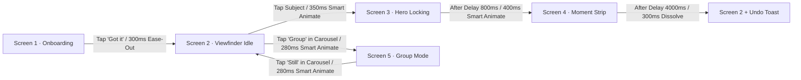

# STILL: Complete Figma Replication & Build Guide

> **Project:** STILL — The Camera That Waits For You  
> **Challenge:** VinnovateIT Round 1 Challenge · UI/UX Subdomain (*"Where did my button go? Rethink the Interaction"*)  
> **Target Canvas:** iPhone 14 / 15 / 13 Pro (`390 × 844 px`)  
> **Source Code Match:** 100% 1:1 match with React + TypeScript codebase  

---

## 1. Canvas & Project Hierarchy Setup

In your Figma project file, create the following pages to maintain professional design organization:

1. **Cover & Overview** — Project hero composite, title card, and submission links.
2. **Tokens & Local Variables** — Color palettes, spacing primitives, corner radii, and text styles.
3. **Master Components** — Atoms and molecules (`LockRing`, `GlassChip`, `IconButton`, `MomentStrip`, `Toast`, `ModeCarousel`).
4. **Hi-Fi Screens (5 Flows)** — The 5 core screens laid out side-by-side with 80px horizontal gap.
5. **Interactive Prototype** — Smart Animate wiring connections for live interactive playback.

### Frame Preset Specifications
- **Device Frame:** `iPhone 14 & 15 Pro`
- **Width:** `390 px`
- **Height:** `844 px`
- **Corner Radius:** `48 px` (or clip content if inside mockup bezel)
- **Background Color:** `#0B0B0F`
- **Layout Grid (Mobile):** 4 Columns, Margins `16 px`, Gutters `12 px`. Optional 8-pt baseline grid (`8 px` increments).

---

## 2. Figma Local Variables (Copy-Paste Ready)

Create a Variable Collection in Figma named **`STILL-Tokens`** and add the following entries:

### 2.1 Color Tokens

| Variable Name | Hex Code | Opacity | Role / Purpose |
|---|---|---|---|
| `color/bg` | `#0B0B0F` | 100% | Primary darkroom canvas background |
| `color/surface-1` | `#14141E` | 100% | Primary elevated cards & dialogs |
| `color/surface-2` | `#1E1E2C` | 100% | Secondary hover states & toast background |
| `color/text-primary` | `#F5F5F7` | 100% | Main headlines, body copy, active icons |
| `color/text-dim` | `#A3A3B2` | 100% | Secondary labels, captions, inactive states |
| `color/text-muted` | `#6E6E80` | 100% | Footers, micro-copy, timestamps |
| `color/accent-amber` | `#FFB020` | 100% | **Signal Amber**: ring fill, Best badge, active mode |
| `color/accent-soft` | `#FFB020` | 14% | Background tint for accent chips & callouts |
| `color/accent-glow` | `#FFB020` | 30% | Drop-shadow glow for hero ring & active frame |
| `color/success-green` | `#3DDC97` | 100% | Ready status, face detection confirmed, save tick |
| `color/danger-coral` | `#FF6B5E` | 100% | Tremor / excessive movement warning, unsteadiness |
| `color/ring-track` | `#FFFFFF` | 22% | Inactive / background circle for focus ring |
| `color/glass-bg` | `#14141E` | 70% | Frosted glass fill (use with Background Blur 20px) |
| `color/glass-border` | `#FFFFFF` | 8% | 1px border for glass containers & chips |

### 2.2 Corner Radii Tokens

| Variable Name | Value | Use Cases |
|---|---|---|
| `radius/chip` | `8 px` | Tag chips, small badges |
| `radius/pill` | `999 px` | Buttons, modal pills, circular rings |
| `radius/card` | `16 px` | Moment Strip thumbnails, dialog cards |
| `radius/sheet` | `28 px` | Bottom sheets, onboarding modal cards |
| `radius/device` | `48 px` | iPhone 14/15 phone bezel curvature |

### 2.3 Spacing Tokens (8-pt Grid)
`space/1`: 4px · `space/2`: 8px · `space/3`: 12px · `space/4`: 16px · `space/5`: 20px · `space/6`: 24px · `space/8`: 32px · `space/12`: 48px.

### 2.4 Typography Styles

| Style Name | Font Family | Weight | Size | Line Height | Letter Spacing |
|---|---|---|---|---|---|
| `Display / Hero` | **Space Grotesk** | Bold (700) | 40 px | 46 px | -0.03em |
| `Headline / Large` | **Space Grotesk** | Bold (700) | 28 px | 34 px | -0.02em |
| `Title / Section` | **Space Grotesk** | SemiBold (600) | 20 px | 26 px | -0.01em |
| `Body / Prominent` | **Inter** | Medium (500) | 16 px | 24 px | 0.00em |
| `Body / Regular` | **Inter** | Regular (400) | 14 px | 20 px | 0.00em |
| `Caption / Label` | **Inter** | Medium (500) | 12 px | 16 px | +0.02em |
| `Micro / Tag` | **Inter** | SemiBold (600) | 11 px | 14 px | +0.05em (Caps) |

---

## 3. Base Component Construction Recipes

### Component 1: `IconButton` (Interactive Icon Container)
- **Frame:** Auto Layout (Center / Center), Dimensions `44 × 44 px` (Strict WCAG touch target).
- **Corner Radius:** `999 px` (Circle).
- **Fill:** `color/glass-bg` (`rgba(20, 20, 30, 0.70)`).
- **Stroke:** 1px Inside `color/glass-border` (`rgba(255, 255, 255, 0.08)`).
- **Effects:** Background Blur `16 px`.
- **Icon Layer:** Lucide icon (e.g. `Zap`, `Settings2`, `RotateCcw`), size `18 × 18 px`, color `color/text-primary`.
- **Variants:**
  - `State=Default` (Icon color `#F5F5F7`).
  - `State=Active` (Fill `rgba(255, 176, 32, 0.20)`, Stroke `#FFB020`, Icon `#FFB020`).

---

### Component 2: `GlassChip` (Pill Status Indicator)
- **Frame:** Auto Layout (Horizontal, Center Left), Hug contents. Height `32 px` (wrapped in `44 px` clickable hit-box if interactive).
- **Padding:** Left/Right `14 px`, Top/Bottom `6 px`, Gap `6 px`.
- **Corner Radius:** `999 px` (Pill).
- **Fill:** `color/glass-bg`.
- **Stroke:** 1px Inside `color/glass-border`.
- **Effects:** Background Blur `16 px`.
- **Content:**
  - Optional leading icon (`14 × 14 px`).
  - Text label: `Caption / Label` (`12 px` or `13 px`, Inter Medium).
- **Variants:**
  - `Variant=Default`: Text `#D1D1DB`, Stroke `rgba(255, 255, 255, 0.08)`.
  - `Variant=Accent`: Text `#FFB020`, Fill `rgba(255, 176, 32, 0.14)`, Stroke `rgba(255, 176, 32, 0.35)`.
  - `Variant=Success`: Text `#3DDC97`, Fill `rgba(61, 220, 151, 0.14)`, Stroke `rgba(61, 220, 151, 0.35)`.

---

### Component 3: `LockRing` (The Hero Focus Mechanism)
- **Frame:** `104 × 104 px` (Fixed, Center / Center).
- **Layer 1 (Track):** Ellipse `104 × 104 px`, Fill: None, Stroke: `4 px` Inside `color/ring-track` (`rgba(255,255,255,0.22)`).
- **Layer 2 (Sweep Arc):** Duplicate Ellipse `104 × 104 px`. In Figma, drag the arc handle:
  - Sweep: `60%` (for Screen 3) or `100%` (for captured).
  - Stroke: `4 px` Inside `color/accent-amber` (`#FFB020`), Stroke Cap: Round.
- **Layer 3 (Tracking Brackets):** 4 Corner brackets (L-shapes, width `10 px`, height `10 px`, stroke `2 px` `#FFB020`, radius `2 px`) anchored at `(-8px, -8px)` around the ring perimeter.
- **Layer 4 (Center Pin):** Ellipse `6 × 6 px`, Fill `#FFB020`, centered.
- **Variants:**
  - `State=Ghost`: Only Track visible, Opacity 35%.
  - `State=Locking-60`: 60% Arc sweep, brackets visible, amber glow `0 0 16px rgba(255, 176, 32, 0.3)`.
  - `State=Captured-100`: 100% complete ring, green/amber bloom pulse.
  - `State=Unsteady`: Track and arc turn `color/danger-coral` (`#FF6B5E`), 2px jitter offset.

---

### Component 4: `MomentStrip` (The 7-Frame Rewind Scrubber)
- **Frame:** Auto Layout (Vertical, Center), Width `358 px`, Hug height.
- **Top Bar:** Auto Layout (Horizontal, Space Between), Width `100%`.
  - Left Text: "Pick your favourite moment" (`13 px`, Inter Medium, `#F5F5F7`).
  - Right Chip: "Rewind 3s" (`12 px`, `#FFB020`, Sparkles icon).
- **Card Strip Row:** Auto Layout (Horizontal, Center), Gap `8 px`, Clip content: Off.
  - Contains **7 Thumbnail Cards**:
    - Normal Thumbnails (1, 2, 4, 5, 6, 7): Width `46 px`, Height `68 px`, Radius `10 px`, Stroke 1px `rgba(255,255,255,0.12)`.
    - **Selected Best Thumbnail (Frame 3)**: Width `52 px`, Height `76 px` (Scale 1.08), Radius `12 px`, Stroke `2.5 px` `#FFB020`, Drop Shadow `0 8px 24px rgba(255, 176, 32, 0.35)`. Top badge: "BEST" (`9 px`, Bold, Black on Amber).
- **Autosave Countdown Line:** Width `100%`, Height `3 px`, Radius `999 px`, Background `rgba(255,255,255,0.1)`. Inside fill: `#FFB020` with Width `70%`.
- **Micro-copy row:** "Saving best moment..." (`12 px`, `#A3A3B2`) and "1.2s" right-aligned.
- **Action Button:** Auto Layout (Center), Width `100%`, Height `44 px`, Radius `999 px`, Fill `#FFB020`, Text: "Save Selection" (`14 px`, Inter Bold, `#0B0B0F`).

---

### Component 5: `Toast` (Reversible Undo Notification)
- **Frame:** Auto Layout (Horizontal, Space Between, Center V), Width `358 px`, Height `48 px`.
- **Padding:** Left/Right `16 px`, Top/Bottom `12 px`.
- **Corner Radius:** `14 px`.
- **Fill:** `#1E1E2C` (Surface 2).
- **Stroke:** 1px Inside `rgba(255, 255, 255, 0.12)`.
- **Drop Shadow:** `0 12px 32px rgba(0, 0, 0, 0.6)`.
- **Left Group:** Auto Layout (Horizontal, Gap `10 px`), Checkmark icon (`16 px`, `#3DDC97`) + Text "Saved to gallery" (`14 px`, `#F5F5F7`).
- **Right Button:** Text "Undo" (`14 px`, Inter SemiBold, `#FFB020`, minimum 44px tap zone).

---

### Component 6: `ModeCarousel` (Bottom Mode Switcher)
- **Frame:** Auto Layout (Horizontal, Center), Gap `20 px`, Height `44 px`.
- **Items:** Text labels: "Still" · "Group" · "Doc".
- **Active State ("Still" or "Group"):** Text color `#FFB020`, Font-Weight 600, with a `4 × 4 px` amber dot centered directly beneath.
- **Inactive States:** Text color `#A3A3B2`, Font-Weight 500.

---

## 4. Screen-by-Screen Construction Instructions

### Screen 1: Progressive Onboarding (`screen-01-onboarding`)
1. **Background Layer:** Place `public/scenes/onboarding-bg.jpg` (or `export/screens/screen-01-onboarding.png`), fill frame `390 × 844 px`, object-fit cover.
2. **Backdrop Dimmer:** Add a dark overlay rectangle (`#0B0B0F`, Opacity 45%).
3. **Animated Demo Ring:** Place `LockRing` component at `X: 143, Y: 240` (Progress 60%, dimensions `104 × 104 px`). Below it, add a `GlassChip` with "Hold steady · 0.5s".
4. **Bottom Onboarding Card:**
   - Frame at bottom: Width `358 px`, X: `16 px`, Y: `490 px`.
   - Radius: `28 px`.
   - Fill: `rgba(20, 20, 30, 0.95)`, Stroke: 1px `rgba(255, 255, 255, 0.12)`. Background Blur `24 px`.
   - Title: **"No shutter. Just stillness."** (`22 px`, Space Grotesk Bold, `#F5F5F7`).
   - 3-Step List (Auto Layout Vertical, Gap `12 px`):
     - Step 1: Amber badge "1" + "Tap what matters to set focus."
     - Step 2: Amber badge "2" + "Hold still while the ring fills (~0.8s)."
     - Step 3: Amber badge "3" + "Rewind to pick your best moment afterwards."
   - Primary CTA Button: Width `100%`, Height `48 px`, Radius `999 px`, Fill `#FFB020`, Text: **"Got it"** (Black `#0B0B0F`, Bold 15px).
   - Secondary link: "Adjust steadiness sensitivity" (`12 px`, `#A3A3B2`).

---

### Screen 2: Viewfinder Idle (`screen-02-idle`)
1. **Background Layer:** Place `public/scenes/portrait-subject.jpg`, fill frame `390 × 844 px`.
2. **Top Gradient Scrim:** Linear gradient rectangle, Top 0 to Height `140 px` (`rgba(11, 11, 15, 0.75)` to `transparent`).
3. **Bottom Gradient Scrim:** Linear gradient rectangle, Bottom to Height `200 px` (`rgba(11, 11, 15, 0.85)` to `transparent`).
4. **Top Bar (Safe Area Top 47px):**
   - Left: `IconButton` (`Zap` flash icon).
   - Center: `GlassChip` (`Sun` icon + "Good Light · 1×").
   - Right: `IconButton` (`Settings2` icon).
5. **Center Ghost Ring:** Place `LockRing` at `X: 143, Y: 330` in `State=Ghost` (opacity 28%).
6. **Coachmark Dwell Pill:** Centered at `Y: 460 px`, `GlassChip` with leading dot: **"Tap what you want to keep"** (fades after 1.5s).
7. **Bottom Controls Bar (Safe Area Bottom 34px):**
   - Left: Recent Gallery Thumbnail (`44 × 44 px`, Radius `12 px`, image `moment-3.jpg`).
   - Center: `ModeCarousel` with **"Still"** active (amber dot below).
   - Right: `IconButton` (`RotateCcw` lens switcher).
   - *Crucial note:* NO SHUTTER BUTTON in bottom center! Clean, unobstructed viewfinder.

---

### Screen 3: Hero Locking (`screen-03-locking`)
1. **Background Layer:** `public/scenes/portrait-subject.jpg`, dimmed 8% (`brightness: 0.92, contrast: 1.05`).
2. **Radial Focus Vignette:** Ellipse gradient centered at `X: 195, Y: 380`, transparent at center to `rgba(11, 11, 15, 0.45)` at edges.
3. **Top Bar:** Same safe area layout with `GlassChip` set to **"Locking Focus · 1×"** (`color/accent-amber`).
4. **Hero Focus Lock Group (Centered on Portrait Eye at X: 195, Y: 380):**
   - `LockRing` at **60% linear progress** with 4 corner tracking brackets.
   - Dynamic timing chip placed `12 px` below ring: `GlassChip` (Hand icon + **"Hold steady · 0.3s"**).
5. **Bottom Steadiness Waveform Meter (Replaces shutter location):**
   - Container centered at `Y: 670 px`, Width `180 px`.
   - Label: `Activity` icon + "Device Steadiness Meter" (`12 px`, Inter Medium, `#FFB020`).
   - SVG Waveform Line: Sine wave path that straightens horizontally, Stroke `2.5 px` `#FFB020`, Width `160 px`.
6. **Bottom Controls Bar:** Gallery thumbnail, ModeCarousel ("Still"), and lens switcher.
7. *(Optional Annotation Version):* Add circular amber numbered badges ①, ②, ③ as detailed in the Case Study.

---

### Screen 4: Moment Strip (`screen-04-moments`)
1. **Top 62% Image Canvas:**
   - Display full-resolution chosen frame: `public/scenes/moment-3.jpg` (or selected index).
   - Top Bar: Left `IconButton` (`X` close), Center `GlassChip` (Sparkles icon + **"Best Moment"**), Right `IconButton` (`Share2` share).
2. **Bottom 38% Moment Strip Sheet:**
   - Bottom sheet container docked from `Y: 520 px` to `844 px`.
   - Mount `MomentStrip` component.
   - 7 Frame Thumbnails visible: Frame 4 highlighted with `2.5 px` amber border, scale `1.08`, and "BEST" badge.
   - Autosave progress line running at 70% fill ("Saving best moment... 1.2s").
   - Primary CTA Button: **"Save Selection"** (`#FFB020`).
3. **Toast Variant:** If demonstrating save confirmation, float `Toast` component at `X: 16 px, Y: 460 px` with "Saved to gallery · Undo".

---

### Screen 5: Group Mode (`screen-05-group`)
1. **Background Layer:** Place `public/scenes/group-campus.jpg` (4 students cleanly framed across the scene).
2. **Global Perimeter Ring:** Add a 3px rounded rectangle frame (`Inset: 16 px`, Radius `32 px`, Stroke `color/accent-amber`, soft outer glow `0 0 24px rgba(255, 176, 32, 0.3)`).
3. **Top Header:** Center `GlassChip` with Users icon: **"3 of 4 ready"** (`color/accent-amber`).
4. **4 Face Detection Boxes (Exact Positions over Subjects):**
   - **Subject 1 (Tara · Left, red shirt, laughing with eyes shut):**
     - Rectangle at `X: 45, Y: 392, W: 54, H: 68 px`.
     - Stroke: `2 px` `#FFB020` (Amber).
     - Pill Chip: **"Tara · Blinking"** (Amber fill, `#0B0B0F` text).
   - **Subject 2 (Aarav · Center-left, blue shirt, smiling):**
     - Rectangle at `X: 121, Y: 396, W: 48, H: 68 px`.
     - Stroke: `2 px` `#3DDC97` (Green).
     - Pill Chip: **"Aarav"** (Green fill).
   - **Subject 3 (Pooja · Center-right, white shirt, smiling):**
     - Rectangle at `X: 212, Y: 405, W: 47, H: 68 px`.
     - Stroke: `2 px` `#3DDC97` (Green).
     - Pill Chip: **"Pooja"** (Green fill).
   - **Subject 4 (Neha · Far-right, navy graphic tee, smiling):**
     - Rectangle at `X: 285, Y: 388, W: 49, H: 68 px`.
     - Stroke: `2 px` `#3DDC97` (Green).
     - Pill Chip: **"Neha"** (Green fill).
5. **Bottom Voice Hint:** Above carousel, add `GlassChip` with Mic icon: **"Or say 'Cheese' / 'Capture'"**.
6. **Bottom Carousel:** Mode set to **"Group"** active (amber indicator).

---

## 5. Interactive Prototyping (Smart Animate Connections)

To make your Figma file feel identical to the live production prototype, link the screens using Figma's **Prototype** mode with these exact parameters:

### Detailed Connection Table

| Source Screen & Node | Interaction Trigger | Destination Screen | Action & Animation | Timing & Curve |
|---|---|---|---|---|
| **Screen 1** `CTA Button ("Got it")` | **On Tap** | **Screen 2** (Idle) | Navigate to Screen 2 Smart Animate | `300 ms` Ease Out `cubic-bezier(0.2, 0.8, 0.2, 1)` |
| **Screen 2** `Viewfinder Canvas (Face)` | **On Tap** | **Screen 3** (Locking) | Navigate to Screen 3 Smart Animate | `350 ms` Ease Out (Ghost ring expands & amber arc fills) |
| **Screen 3** `Entire Frame` | **After Delay (`800 ms`)** | **Screen 4** (Moments) | Navigate to Screen 4 Smart Animate | `400 ms` Ease In & Out (Bloom pulse + Strip slides up from Y:844) |
| **Screen 4** `Button ("Save Selection")` | **On Tap** | **Screen 2** (Idle + Toast) | Navigate to Screen 2 Smart Animate | `300 ms` Ease Out (Moment Strip slides down, Toast appears) |
| **Screen 4** `Frame Timeout` | **After Delay (`4000 ms`)** | **Screen 2** (Idle + Toast) | Navigate to Screen 2 Smart Animate | `300 ms` Automatic autosave fallback |
| **Screen 2** `ModeCarousel ("Group")` | **On Tap** | **Screen 5** (Group) | Navigate to Screen 5 Smart Animate | `280 ms` Ease Out (Viewfinder cross-fades, perimeter ring glows) |
| **Screen 5** `ModeCarousel ("Still")` | **On Tap** | **Screen 2** (Idle) | Navigate to Screen 2 Smart Animate | `280 ms` Ease Out |

---

## 6. Local Asset Directory Map

All high-definition source photos and Playwright exports are located in this workspace:

- **Screen 1 Export (1170×2532):** [`export/screens/screen-01-onboarding.png`](file:///c:/Programming/Projects%20of%20antigravity/project_7_uiux_vinnovateit_switchthebutton/export/screens/screen-01-onboarding.png)
- **Screen 2 Export (1170×2532):** [`export/screens/screen-02-idle.png`](file:///c:/Programming/Projects%20of%20antigravity/project_7_uiux_vinnovateit_switchthebutton/export/screens/screen-02-idle.png)
- **Screen 3 Export (1170×2532):** [`export/screens/screen-03-locking.png`](file:///c:/Programming/Projects%20of%20antigravity/project_7_uiux_vinnovateit_switchthebutton/export/screens/screen-03-locking.png)
- **Screen 3 Annotated (1170×2532):** [`export/screens/screen-03-locking-annotated.png`](file:///c:/Programming/Projects%20of%20antigravity/project_7_uiux_vinnovateit_switchthebutton/export/screens/screen-03-locking-annotated.png)
- **Screen 4 Export (1170×2532):** [`export/screens/screen-04-moments.png`](file:///c:/Programming/Projects%20of%20antigravity/project_7_uiux_vinnovateit_switchthebutton/export/screens/screen-04-moments.png)
- **Screen 5 Export (1170×2532):** [`export/screens/screen-05-group.png`](file:///c:/Programming/Projects%20of%20antigravity/project_7_uiux_vinnovateit_switchthebutton/export/screens/screen-05-group.png)
- **Hero Composite Presentation (2400×1350):** [`export/hero-composite.png`](file:///c:/Programming/Projects%20of%20antigravity/project_7_uiux_vinnovateit_switchthebutton/export/hero-composite.png)
- **User Flow Diagram:** [`export/user-flow.svg`](file:///c:/Programming/Projects%20of%20antigravity/project_7_uiux_vinnovateit_switchthebutton/export/user-flow.svg)
- **Case Study PDF Document:** [`export/case-study.pdf`](file:///c:/Programming/Projects%20of%20antigravity/project_7_uiux_vinnovateit_switchthebutton/export/case-study.pdf)
